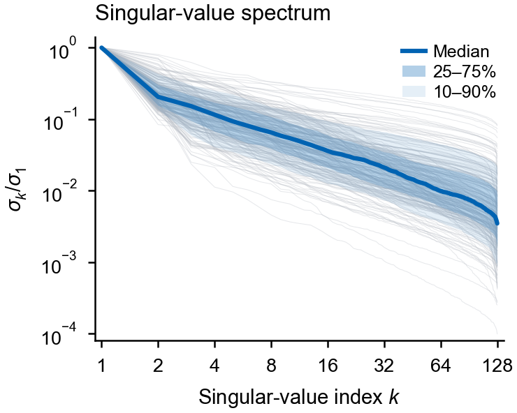
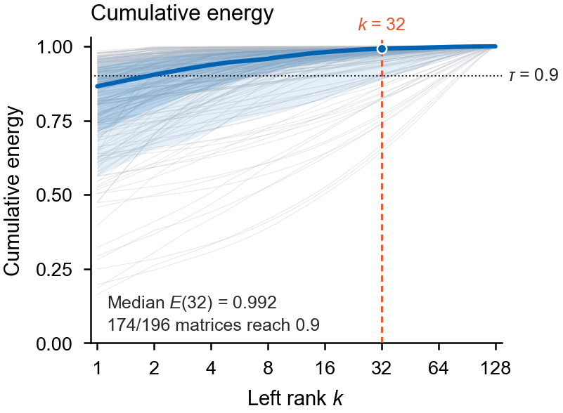
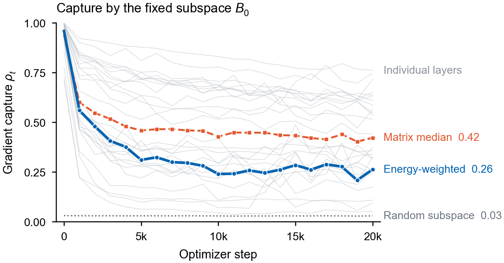
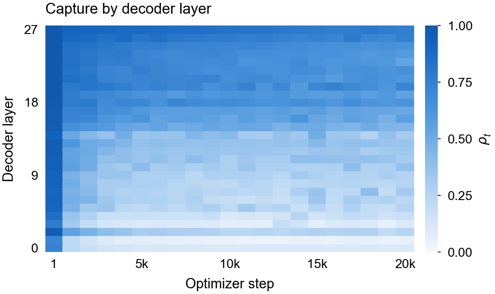
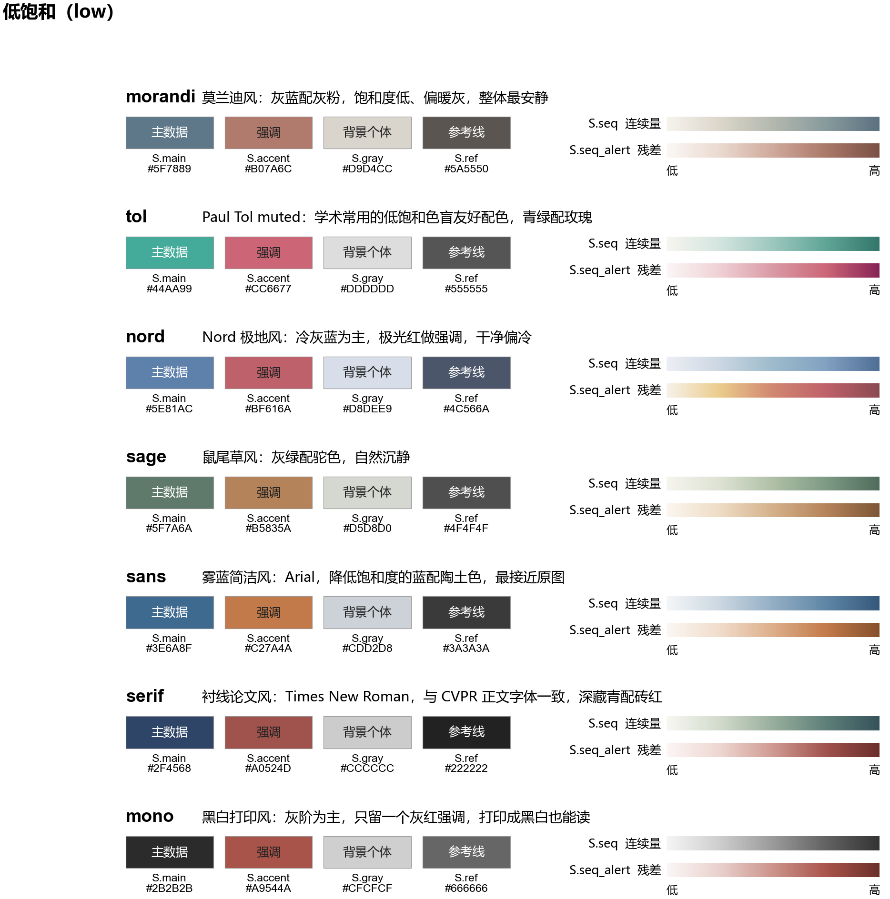
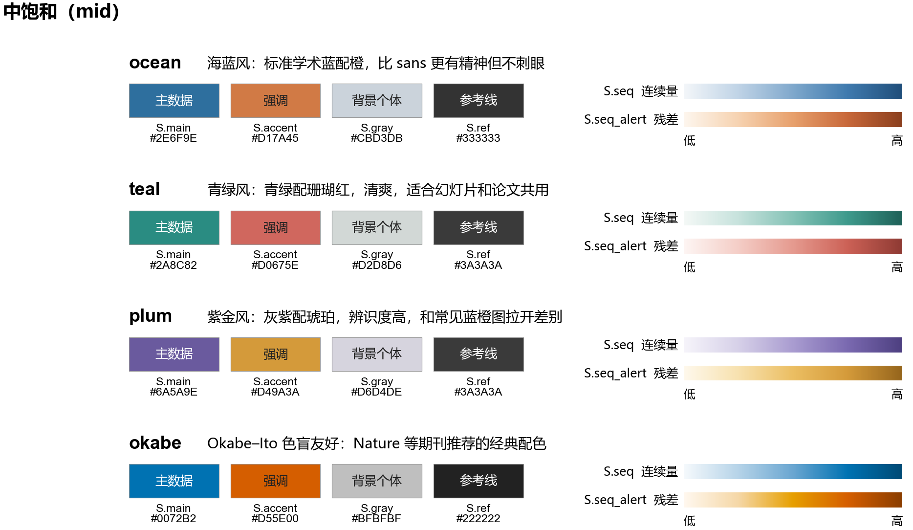
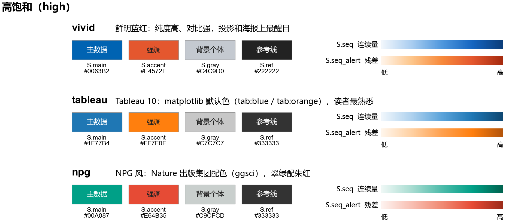
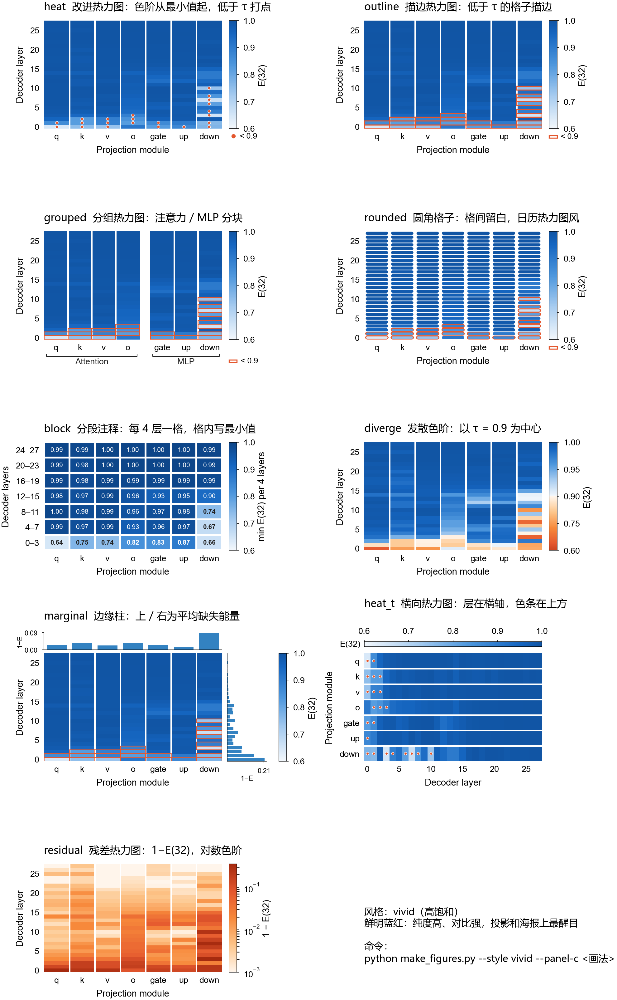

# BiLoZO 论文绘图

## V_3（当前版本）

```bash
python code/make_figures.py            # vivid 配色，四张独立小图 -> figures/V_3/fig1、figures/V_3/fig2
python code/make_figures.py --labels   # 需要时在左上角加 a / b
```

每张小图都有 `pdf/`（投稿用，矢量）、`svg/`（可编辑文字）、`png/`（300 dpi 预览）。Figure 1c 不在本轮范围内，沿用 `figures/V_1/fig1` 的 diverge 版本。

| Figure 1a | Figure 1b |
|---|---|
|  |  |

| Figure 2a | Figure 2b |
|---|---|
|  |  |

### 与 V_2 相比改了什么

| 小图 | V_2 的问题 | V_3 的处理 |
|---|---|---|
| 1a 奇异值谱 | 只有 1 条线却配了图例框；四分位带几乎看不见；线性横轴把 k=1–8 的陡降挤成一根竖线 | 横轴改为 log₂（1, 2, 4, …, 128），前几个奇异值的衰减能看清。分布分三层：极淡的 196 条矩阵线、10–90% 浅带、25–75% 深带，最上面是中位数线。右上角的无框小图例同时说明这三层 |
| 1b 累计能量 | 图中间悬着三行大号说明文字；所有曲线都贴在 y≈1 附近 | 与 1a 用同一个 log₂ 横轴和同样的分布层次。`k = 32` 标在竖线顶端，`τ = 0.9` 标在图右侧外面，中位数在 k=32 处打一个点。数值注释缩成两行小字，放在左下角没有曲线经过的空白处 |
| 2a 捕获率 | 带引线的终点标签，数值用两种格式；标记点过大 | 终点直接写“名称 + 数值”，颜色与线条一致，不用引线。28 条单层线改成浅灰背景，并在右上标注 “Individual layers”。随机基线用中灰点线，比数据线弱、比背景线强。step=1 仍不画标记点，1→1000 的连线保留，纵轴固定 0–1 |
| 2b 逐层热力图 | 色带最深的一端过重，上半部分压成一整块深蓝；层刻度 0, 5, …, 25 不包含最顶层 | 色带截掉最深的 18%，层刻度改为 0 / 9 / 18 / 27。色条去掉外框、变细，与热力图同高。格子边界取相邻 checkpoint 的中点，横轴标为 1, 5k, …, 20k |
| 全部 | 公式里的 E(32)、ρ_t、σ_k 用的是 DejaVu 字形，与 Arial 正文不一致 | `bilozo_style.py` 把 mathtext 改为 Arial（`mathtext.fontset = "custom"`），公式与正文字体统一 |

### 图注要点

- **1a**：每个矩阵的奇异值先除以该矩阵自己的 σ₁，再逐 k 统计跨矩阵的分位数。图中有 196 个矩阵。分位带只描述矩阵之间的差异，不是置信区间。
- **1b**：纵轴为平方奇异值的累计能量比例。在 k=32 处：中位数 E(32)=0.992，174/196 个矩阵达到 0.9。
- **2a**：三条线的含义：
  - 蓝线：全局能量加权捕获率。
  - 橙虚线：各矩阵捕获率的中位数。
  - 灰点线：随机秩 32 子空间的解析期望。
  - 背景浅灰线：逐层能量加权捕获率。

  首个测量点在 step=1，数据来自单个训练 seed。
- **2b**：每个格子是该层在对应 checkpoint 的能量加权捕获率，所有格子共用 0–1 的线性色阶。

### 检查结果

四个 PDF 都检查过：

- 内嵌位图数为 0。
- 字体只有 ArialMT 和 Arial-ItalicMT，均已嵌入。
- SVG 中没有 `<image>`，文字保留为 `<text>`。
- nature-figure 的碰撞审计（`audit_figure_collisions.py`）四张全部 PASS。

`audit_pdf_text.py` 报出 4.9 pt 的文字，都是 σ_k、ρ_t 的数学下标，这是正常的。

## V_2 重绘（Codex 版，已被 V_3 取代）

在本目录运行 `python code/make_figures.py`，默认使用 vivid 配色，将四张独立小图导出到 `figures/V_2/fig1` 与 `figures/V_2/fig2`。各图提供矢量 PDF、可编辑文字的 SVG 和 300 dpi PNG 预览。论文排版时按绘图区对齐，Figure 2a 的终点标签和 Figure 2b 的色条占用额外画布宽度。

| 小图 | 图注要点 |
|---|---|
| Figure 1a | 每个矩阵的奇异值除以该矩阵的首个奇异值。细灰线表示全部 196 个矩阵，蓝线表示逐索引中位数，浅蓝带表示第 25 至第 75 百分位数。 |
| Figure 1b | 纵轴为累计平方奇异值能量比例。灰线、蓝线和色带与 1a 的统计层次相同。横线标记 90% 阈值，竖线标记左秩 32。 |
| Figure 2a | 蓝线为全局能量加权捕获率，橙线为矩阵捕获率中位数，灰虚线为随机秩 32 子空间的解析期望，细灰线为逐层能量加权捕获率。首个测量发生于 step=1，折线保留该测量。 |
| Figure 2b | 每格为该层在对应 checkpoint 的能量加权捕获率。首列对应 step=1，所有格子使用同一 0–1 色阶。 |

Figure 1 的分位带描述矩阵间分布。Figure 2 来自单个训练 seed。两组图的计算口径见 `data/figure_notes.txt`。Figure 1c 的既有 diverge 版本位于 `figures/V_1/fig1`。如需另生成指定画法的 Figure 1c，可显式传入 `--panel-c`。

## V_1 及早期风格记录

本目录用 Qwen3-0.6B / SST-2（左秩 32，右秩 1）的真实实验数据，重绘两张图：

- Figure 1：跨 batch 低秩
- Figure 2：固定 $B_0$ 的梯度捕获率

当前定稿设置：

- 配色：`vivid`
- Figure 1 子图 c：`diverge` 画法
- 每个子图单独输出一张图

另外还保留 14 种配色（按饱和度分低、中、高三组）和子图 c 的 9 种画法，供以后切换。

## 目录结构

```
绘图/
├── code/
│   ├── bilozo_style.py    # 风格模板：14 种配色（低/中/高饱和三组）、字号、CVPR 尺寸、矢量导出
│   ├── bilozo_data.py     # 读取 data/，计算 E(32) 网格与捕获率曲线
│   ├── make_figures.py    # 5 张单独的小图：fig1a/b/c、fig2a/b；子图 c 的 9 种画法
│   └── make_palettes.py   # 生成三组色板参考图
├── data/                  # 复制自 BiloZO/数据：spectra.csv、capture.csv、figure_notes.txt
└── figures/
    ├── fig1/              # Figure 1 的三张小图
    │   ├── pdf/           #   fig1a.pdf  fig1b.pdf  fig1c.pdf   矢量，插入 LaTeX 用
    │   ├── svg/           #   同上，可在 Illustrator / Inkscape 里改（文字保持可编辑）
    │   └── png/           #   300 dpi 预览，不用于投稿
    ├── fig2/              # Figure 2 的两张小图：fig2a、fig2b（结构同上）
    ├── options/           # 子图 c 九种画法的对比页（仅在加 --options 时生成）
    ├── palettes/          # 色板参考图 palettes_low/mid/high（pdf/svg/png）
    └── 参考0/             # 之前生成的全部风格整图与对比页，留作参考
```

## 运行

在 `code/` 目录下运行：

```bash
python make_figures.py                                   # 默认：vivid 配色，子图 c 用 diverge，输出 5 张小图
python make_figures.py --labels                          # 每张小图左上角加 a / b / c
python make_figures.py --style morandi --panel-c outline # 换配色或子图 c 的画法（会覆盖 fig1/、fig2/ 里的文件）
python make_figures.py --options                         # 额外生成当前配色下子图 c 九种画法的对比页
python make_palettes.py                                  # 重新生成三张色板参考图
```

- `--style`：默认 `vivid`，可选值如下。
  - 低饱和：`morandi`、`tol`、`nord`、`sage`、`sans`、`serif`、`mono`
  - 中饱和：`ocean`、`teal`、`plum`、`okabe`
  - 高饱和：`vivid`、`tableau`、`npg`
- `--panel-c`：默认 `diverge`，可选 `heat`、`outline`、`grouped`、`rounded`、`block`、`diverge`、`marginal`、`heat_t`、`residual`。
- `--labels`：默认不写面板字母，方便在 LaTeX 里用 `subcaption` 统一编号。

### 输出的 5 张小图

| 文件 | 内容 | PDF 尺寸 |
|---|---|---|
| `fig1/pdf/fig1a.pdf` | 各矩阵归一化奇异值谱，粗线为中位数 | 约 2.1 × 2.0 in |
| `fig1/pdf/fig1b.pdf` | 累计能量曲线，τ=0.9 虚线、k=32 竖线 | 约 2.0 × 2.0 in |
| `fig1/pdf/fig1c.pdf` | E(32) 热力图，`diverge` 发散色阶（以 τ=0.9 为中心） | 约 2.4 × 2.0 in |
| `fig2/pdf/fig2a.pdf` | 捕获率 ρ_t 随步数变化；step=1 处不画标记点，但保留 1→1000 的连线，纵轴 0–1 | 约 3.1 × 2.1 in |
| `fig2/pdf/fig2b.pdf` | 逐层捕获率热力图（层 × 步） | 约 3.5 × 2.1 in |

同一张大图里，各小图的绘图区（坐标轴本身）尺寸相同：Figure 1 是 1.6 × 1.5 in，Figure 2 是 2.6 × 1.6 in，并排放时大小一致。这两个尺寸可在 `make_figures.py` 的 `FIG1_AX`、`FIG2_AX` 里改。

### 在 LaTeX 中拼成大图

```latex
\begin{figure*}[t]
  \centering
  \begin{subfigure}{0.31\linewidth}\includegraphics[width=\linewidth]{fig1/pdf/fig1a.pdf}\caption{}\end{subfigure}\hfill
  \begin{subfigure}{0.31\linewidth}\includegraphics[width=\linewidth]{fig1/pdf/fig1b.pdf}\caption{}\end{subfigure}\hfill
  \begin{subfigure}{0.35\linewidth}\includegraphics[width=\linewidth]{fig1/pdf/fig1c.pdf}\caption{}\end{subfigure}
  \caption{...}
\end{figure*}
```

需要 `\usepackage{subcaption}`。小图是按约 1:1 的印刷尺寸画的，宽度比例尽量接近 PDF 实际宽度，字号就不会被明显缩放。

## 画新图的写法

```python
import matplotlib.pyplot as plt
from bilozo_style import use_style, panel_label, save

S = use_style("morandi")                    # 设置全局字体字号，返回配色对象 S
fig, ax = plt.subplots(figsize=(S.col1, 2.0))
ax.plot(x, y_ours, color=S.main, label="BiLoZO")
ax.plot(x, y_base, color=S.accent, ls="--", label="AGZO")
ax.axhline(0.9, color=S.ref, ls=":", lw=0.6)
panel_label(ax, "a", S)
save(fig, "my_figure")                      # -> figures/pdf, svg, png
```

### 参数含义

| 参数 | 含义 | 典型用法 |
|---|---|---|
| `S.main` | 主数据色 | 本方法的曲线、主散点、柱状图 |
| `S.accent` | 强调色 | 对照方法、选定的秩（如 k=32 竖线）、低于阈值的格子描边 |
| `S.gray` | 背景个体色 | 逐层 / 逐矩阵的细曲线，作为主曲线的背景 |
| `S.ref` | 参考线色 | 随机基线、τ 阈值虚线、中位数横线、注释文字 |
| `S.seq` | 连续量色带（浅=低，深=高） | 越大越好的量，如 E(32)、$\rho_t$ |
| `S.seq_alert` | 残差色带（浅=小，深=大） | 要突出“缺失 / 误差”的量，如 1−E(32) |
| `S.group` | 饱和度分组 | `low` / `mid` / `high` |
| `S.col1` | 单栏宽 3.25 in | `figsize=(S.col1, 高度)` |
| `S.col2` | 通栏宽 6.875 in | `figsize=(S.col2, 高度)` |
| `S.grid` | 是否画浅灰网格 | 所有风格统一为 False，开关方法见下方“网格开关” |
| `panel_label(ax, "a", S)` | 在子图左上角写粗体字母 | `x` 参数可左右微调 |
| `save(fig, name)` | 同时导出 PDF、SVG、PNG | 文件名不带后缀 |

### 网格开关

所有风格默认都不画网格。需要网格时，按作用范围选下面一种方法。

**1. 只给某一个子图开网格**（推荐）

```python
S = use_style("morandi")
fig, ax = plt.subplots(figsize=(S.col1, 2.0))
ax.grid(True)                        # 横竖网格都画
ax.grid(True, axis="y")              # 只画横线，便于读数
ax.grid(True, which="major")         # 对数轴只在主刻度画，不画次刻度
ax.set_axisbelow(True)               # 网格压在数据下面
```

**2. 当前脚本里所有子图都开网格**

在 `use_style()` 之后加一行，它会覆盖风格里的设置：

```python
S = use_style("morandi")
plt.rcParams["axes.grid"] = True
```

**3. 让某个风格永久带网格**

在 `code/bilozo_style.py` 的 `STYLES` 里找到这个风格，把 `grid=False` 改成 `grid=True`。

**网格的样式**

网格的颜色和线宽在 `use_style()` 里的 `"grid.color": "#E6E6E6"` 和 `"grid.linewidth": 0.5` 两项。

**热力图不受影响**

热力图子图在 `_heat_axes()` 中强制调用了 `ax.grid(False)`，所以即使开了网格，热力图的格子上也不会出现网格线。

字号统一如下：

- 正文 7 pt，标题 7.5 pt，刻度与图例 6.5 pt，面板字母 9 pt 粗体。
- 线宽：坐标轴 0.6 pt，主曲线 1.2–1.5 pt，背景曲线 0.3–0.5 pt。

## 配色：低 / 中 / 高饱和三组

所有色带都是“近白 → 单一色相加深”的形式，不使用 viridis、jet 这类彩虹色带。

### 低饱和（论文正文首选）



| 风格 | 字体 | `S.main` | `S.accent` | `S.gray` | `S.ref` | `S.seq`（浅 → 深） | `S.seq_alert`（浅 → 深） |
|---|---|---|---|---|---|---|---|
| `morandi` 莫兰迪 | Arial | `#5F7889` | `#B07A6C` | `#D9D4CC` | `#5A5550` | `#F6F3EE` `#DCD6CA` `#B3B8AE` `#879A9C` `#5B7180` | `#FBF8F4` `#EAD9CF` `#CFA99B` `#AA7869` `#7A5045` |
| `tol` Paul Tol muted | Arial | `#44AA99` | `#CC6677` | `#DDDDDD` | `#555555` | `#F7F5EF` `#D3E4DF` `#9CC7BD` `#5FA597` `#33766B` | `#FBF6F6` `#EFD0D4` `#D99AA5` `#CC6677` `#882255` |
| `nord` 极地 | Arial | `#5E81AC` | `#BF616A` | `#D8DEE9` | `#4C566A` | `#ECEFF4` `#CBD6E2` `#9DBBCB` `#81A1C1` `#4F6E96` | `#F6F2EA` `#EBCB8B` `#D08770` `#BF616A` `#8A4A52` |
| `sage` 鼠尾草 | Arial | `#5F7A6A` | `#B5835A` | `#D5D8D0` | `#4F4F4F` | `#F5F4EE` `#DDE2D3` `#AFC0A6` `#7D9A84` `#4F6B5C` | `#FBF6EF` `#EEDCC4` `#D4B08A` `#B5835A` `#7D5636` |
| `sans` 雾蓝 | Arial | `#3E6A8F` | `#C27A4A` | `#CDD2D8` | `#3A3A3A` | `#F4F6F8` `#CBD7E1` `#93AEC4` `#5F86A6` `#34587A` | `#FBF7F3` `#F0DCCB` `#DDAE8A` `#C27A4A` `#86502C` |
| `serif` 衬线论文 | Times New Roman | `#2F4568` | `#A0524D` | `#CCCCCC` | `#222222` | `#F7F7F2` `#D2DACB` `#98AE9C` `#5E7F79` `#35525A` | `#FBF6F4` `#EED6D1` `#CF9A92` `#A0524D` `#6A2E2B` |
| `mono` 黑白打印 | Arial | `#2B2B2B` | `#A9544A` | `#CFCFCF` | `#666666` | `#F5F5F5` `#CDCDCD` `#9A9A9A` `#626262` `#333333` | `#FAF7F6` `#E9D0CC` `#CB938B` `#A9544A` `#6B302A` |

### 中饱和（论文与幻灯片通用）



| 风格 | 字体 | `S.main` | `S.accent` | `S.gray` | `S.ref` | `S.seq`（浅 → 深） | `S.seq_alert`（浅 → 深） |
|---|---|---|---|---|---|---|---|
| `ocean` 海蓝 | Arial | `#2E6F9E` | `#D17A45` | `#CBD3DB` | `#333333` | `#F3F6F9` `#BFD3E6` `#7FA8CC` `#3F7AAE` `#1F4E7A` | `#FDF6EE` `#F6D2B0` `#E7A06C` `#C8683A` `#8A3F1E` |
| `teal` 青绿 | Arial | `#2A8C82` | `#D0675E` | `#D2D8D6` | `#3A3A3A` | `#F4F8F6` `#C6E2DC` `#84C2B6` `#3E9A8C` `#1E6158` | `#FDF5F3` `#F4CDC6` `#E59A8F` `#CC6156` `#8E3A33` |
| `plum` 紫金 | Arial | `#6A5A9E` | `#D49A3A` | `#D6D4DE` | `#3A3A3A` | `#F6F4FA` `#D6D0E8` `#A99CD0` `#7A69B0` `#4D3F80` | `#FEF8EC` `#F7E1AE` `#EBBE62` `#D49A3A` `#95651C` |
| `okabe` Okabe–Ito | Arial | `#0072B2` | `#D55E00` | `#BFBFBF` | `#222222` | `#F5F9FC` `#B5D3E8` `#6AA6D1` `#0072B2` `#004A75` | `#FFF8EF` `#F5D7A6` `#E69F00` `#D55E00` `#8A3D00` |

### 高饱和（投影、海报、需要最强对比时用）



| 风格 | 字体 | `S.main` | `S.accent` | `S.gray` | `S.ref` | `S.seq`（浅 → 深） | `S.seq_alert`（浅 → 深） |
|---|---|---|---|---|---|---|---|
| `vivid` 鲜明蓝红 | Arial | `#0063B2` | `#E4572E` | `#C4C9D0` | `#222222` | `#F2F7FC` `#A9CDF0` `#4E97DD` `#1565C0` `#0B3D7A` | `#FFF5EB` `#FDC58A` `#F7893B` `#E4572E` `#A52A0F` |
| `tableau` Tableau 10 | Arial | `#1F77B4` | `#FF7F0E` | `#C7C7C7` | `#333333` | `#F1F7FC` `#AED1EE` `#5AA3DA` `#1F77B4` `#0E4772` | `#FFF6EC` `#FFD0A1` `#FFA04D` `#FF7F0E` `#B3540A` |
| `npg` Nature 出版集团 | Arial | `#00A087` | `#E64B35` | `#C9CFCD` | `#333333` | `#EFF8F6` `#A8DCD1` `#4DBBAA` `#00A087` `#00634F` | `#FEF3F0` `#F8BFB2` `#F08A73` `#E64B35` `#9C2A1A` |

### 配色来源

- `tol` 的主色和强调色取自 Paul Tol 的 muted 方案。tueplots、discovr 等多个软件包给出的色值一致；原始出处是 SRON 技术报告，我没有直接核对那份 PDF。
- `nord` 取自 Nord 官方色板（Frost 组和 Aurora 组）。
- `okabe` 取自 Okabe–Ito 色盲友好配色。
- `tableau` 取自 matplotlib 的 `tab:blue` / `tab:orange`。
- `npg` 取自 ggsci 的 NPG 色板。
- `morandi`、`sage`、`ocean`、`teal`、`plum`、`vivid` 是按“低饱和、中等明度”等原则自行调配的。
- 所有风格的色带（`seq_stops` 和 `alert_stops`）都是以主色或强调色为终点自行插值得到的。

### 怎么选

- 正文默认用低饱和组。
  - 想要最安静的观感：`morandi`。
  - 需要色盲安全：`tol`。
  - 想和 Times 正文统一：`serif`。
  - 可能黑白打印：`mono`。
- 同一套图既放论文又放汇报幻灯片：中饱和组，如 `ocean` 或 `teal`。
- 只用于海报、投影，或者审稿人要求对比更强：高饱和组。
- 同一篇论文的所有图用同一种风格，不要混用。

### 热力图的约定

- `heat` 类画法会截掉 `S.seq` 最深的 15%，避免大面积高值时整块发黑。
- 色阶从数据最小值（向下取整到 0.05）开始，而不是从 0 开始。原图子图 c 难看，主要原因就是色阶从 0 开始。
- 只在模块之间留竖向白缝，不留横缝，避免 28 层变成一排横条纹。

## 子图 c 的九种画法（以 `vivid` 为例）



原来的 bubble、lines、strip、range 只有线条和点，已经删掉。现在 9 种画法都是面积型。以下几种参考了网上的常见做法：

- `block`：参考 matplotlib 官方的注释热力图示例，按格子亮度自动选黑字或白字。
- `rounded`：参考日历热力图的圆角格子。
- `diverge`：以阈值为中心的发散色阶。
- `marginal`：热力图加边缘统计柱。

| 画法 | 说明 | 适合 |
|---|---|---|
| `heat` | 改进热力图，模块间竖缝，低于 τ 的格子打点 | 与原图结构一致，改动最小 |
| `outline` | 同上，低于 τ 的格子用强调色方框描边 | 比打点更利落，推荐 |
| `grouped` | 注意力（q k v o）和 MLP（gate up down）分成两块，下方用括号标注 | 要说明两类模块行为不同时 |
| `rounded` | 每格一个圆角小方块，格间留白 | 观感最“设计感” |
| `block` | 每 4 层合成一格，格内直接写该段最小 E(32)，低于 τ 加粗 | 数值可直接读，适合单栏小图 |
| `diverge` | 以 τ=0.9 为中心的发散色阶：低于 τ 暖色，高于 τ 冷色 | 一眼看出哪些格子不达标 |
| `marginal` | 热力图加上方 / 右侧边缘柱（平均缺失能量 1−E） | 同时看模块和层两个方向的差异 |
| `heat_t` | 横向热力图，层在横轴，色条在上方 | 版面偏扁时 |
| `residual` | 画 1−E(32)，对数色阶 | 强调漏掉了多少能量 |

当前定稿用 `diverge`。想看其他配色下的对比页，运行 `python make_figures.py --style <风格> --options`，输出在 `figures/options/png/fig1c_options_<风格>.png`。

## 当前输出预览（vivid）

| Figure 1a | Figure 1b | Figure 1c |
|---|---|---|
|  |  |  |

| Figure 2a | Figure 2b |
|---|---|
|  |  |

## 矢量图检查

已逐个检查 `figures/fig1/pdf/`、`figures/fig2/pdf/` 下的 5 个 PDF：

- 内嵌位图数均为 0。
- 字体全部嵌入（TrueType，可编辑）。

matplotlib 默认会把色条栅格化，模板里已经用 `cb.solids.set_rasterized(False)` 关掉了。新写热力图时，记得沿用 `make_figures.py` 里的 `_colorbar()`；格子用 `pcolormesh` 或 patch 画，不要用 `imshow`。

## 数据说明

数据来自单个训练 seed（seed=42，20000 步，前向差分，LR=3e-6）。逐层的灰线只是描述性的，不是置信区间。完整说明见 `data/figure_notes.txt`。
